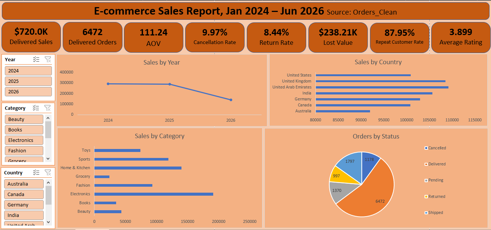
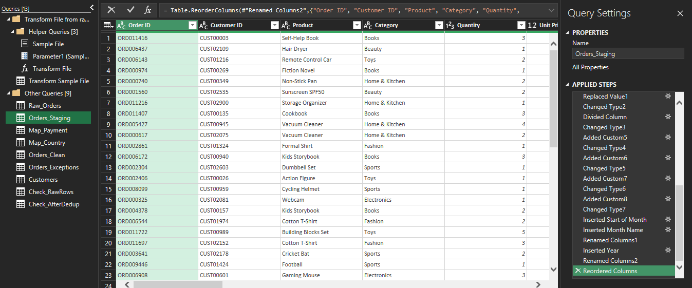
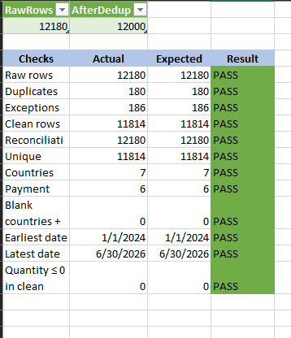

# E-commerce Data Cleaning & Sales Report (Excel + Power Query)

A refreshable Power Query pipeline that turns a messy e-commerce export into a sales report managers can trust (synthetic data).



## Project brief

**Stakeholder:** Head of E-commerce (fictional)

**Problem:** The order system exports a raw CSV. Managers don't trust the sales numbers because of duplicates, mixed date formats and inconsistent country and payment names.

**Goal:** A clean sales report that updates when a new export is dropped into a folder.

**Business questions**
1. How much did we sell (delivered orders), and how is it trending?
2. Which countries and product categories drive sales?
3. How much order value do we lose to cancellations and returns?
4. Should we restrict Cash on Delivery because of cancellations?
5. How many customers come back, and how concentrated are sales?
6. What should we expect for the next 6 months?

**Acceptance criteria**
- No exact duplicate rows, and every Order ID is unique.
- Every date is valid and between 1 Jan 2024 and 30 Jun 2026.
- Exactly 7 countries and 6 payment methods, with 0 unmapped values.
- No quantity of 0 or less in the clean table (those rows go to an Exceptions table).
- Raw rows = duplicates removed + exceptions + clean rows.
- A new export in the folder is picked up by **Data → Refresh All**.

### KPI definitions

| KPI | Definition |
|---|---|
| Net Amount | Quantity × Unit Price × (1 − Discount %) |
| Delivered Sales | Sum of Net Amount for orders with status Delivered |
| Delivered Orders | Number of orders with status Delivered |
| Average Order Value (AOV) | Delivered Sales ÷ Delivered Orders |
| Cancellation rate | Cancelled orders ÷ all valid orders |
| Return rate | Returned orders ÷ all valid orders |
| Lost Value | Sum of Net Amount for Cancelled and Returned orders |
| Repeat-customer rate | Customers with 2 or more valid orders ÷ all customers |
| Average rating | Average Customer Rating, counting only rated orders |

## Dataset

- **Name:** Messy E-Commerce Sales Dataset 2026, by AfaqKhan ([Kaggle](https://www.kaggle.com/))
- **Licence:** CC0 (public domain)
- **Size:** 12,180 rows × 13 columns, orders from Jan 2024 to Jun 2026 in 7 countries
- **Note:** The data is **synthetic** (computer-generated), not real company data.

## Data-quality issues found

| Issue | Column | Fix |
|---|---|---|
| Exact duplicate rows | All | 180 removed |
| 5 different date formats | Order_Date | Each format converted with its own rule |
| 20 spellings of 6 payment methods | Payment_Method | Mapping table |
| 24 spellings of 7 countries | Country | Mapping table |
| Missing city | Shipping_City | Labelled "Unknown" |
| Missing discount | Discount_Percent | Set to 0% and flagged |
| Missing rating | Customer_Rating | Left blank (most are orders that weren't delivered) |
| Quantity of 0 or less | Quantity | 186 rows moved to an Exceptions table |

## Cleaning steps (Power Query)

1. Load every CSV from the `raw_exports` folder (so new exports are picked up automatically).
2. Remove exact duplicate rows.
3. Convert the 5 date formats into one Date column.
4. Map payment methods and countries through lookup tables.
5. Handle missing values (city, discount, rating).
6. Set data types and add calculated columns: Net Amount, Delivered Sales, Status Group, Order Month, Year.
7. Split the data into `Orders_Clean` and `Orders_Exceptions`. Invalid rows are kept for audit, not deleted.



## Checks

Every row is accounted for:

**12,180 raw rows = 180 duplicates + 186 exceptions + 11,814 clean rows**

The Checks sheet runs PASS/FAIL tests for row counts, unique Order IDs, date range and unmapped values. Refresh test: dropping a duplicate export into the folder doubled the raw rows, but the clean table stayed at 11,814 rows and every check still passed.



## Results

| KPI | Value |
|---|---|
| Valid orders | 11,814 |
| Delivered orders | 6,472 (54.8%) |
| Delivered Sales | $719,962 |
| Average Order Value | $111.24 |
| Cancellation rate | 9.97% (1,178 orders) |
| Return rate | 8.44% (997 orders) |
| Lost Value (cancelled + returned) | $238,209 |
| Average rating | 3.90 / 5 |

**Order status:** Delivered 6,472 · Shipped 1,797 · Pending 1,370 · Cancelled 1,178 · Returned 997

**Delivered sales by year:** 2024 $292,088 · 2025 $289,625 · 2026 (Jan–Jun) $138,249

**Top categories:** Electronics $190,826 (26.5%) · Home & Kitchen $140,313 (19.5%) · Sports $118,886 (16.5%)

**Countries:** United Arab Emirates $109,174 (15.2%) is the largest. All 7 markets are between 12.8% (Australia) and 15.2%.

## Findings and recommendations

| Question | Answer | Recommendation |
|---|---|---|
| How much value do we lose to cancellations and returns? | 2,175 orders (18.4% of valid orders), worth about $238K | Investigate the main cancellation and return reasons. Even a small drop adds real revenue. |
| Should we restrict Cash on Delivery? | COD cancellation rate is 9.9%, the same as the 9.97% average | No. The data doesn't support restricting COD. |
| Which categories should marketing focus on? | Electronics and Home & Kitchen make up 46% of delivered sales | Prioritise these two in campaigns and stock planning. |
| Which market is biggest? | UAE at 15.2%, but no market dominates | Growth plans can be spread across all markets. |
| Is sales growing? | Sales are flat: $292K in 2024 and $290K in 2025 | Focus on reducing lost orders rather than expecting growth. |
| How reliable is the export? | 8 types of data-quality problem | Fix at the source: dropdowns for country and payment, one date format (YYYY-MM-DD), a required discount field, and a block on quantity ≤ 0. |

## How to refresh

1. Drop a new CSV export into the `raw_exports` folder.
2. Open `ecommerce_data_cleaning.xlsx` and click **Data → Refresh All**.
3. Check that every test on the Checks sheet still shows PASS.

## Repository structure

```
ecommerce-data-cleaning-power-query/
├── README.md
├── ecommerce_data_cleaning.xlsx
├── data/raw/ecommerce_retail_transactions_raw.csv
├── powerquery/        one .m file per query
└── images/            screenshots (applied steps, dashboard)
```

## Tools

Excel · Power Query (M) · PivotTables and slicers
